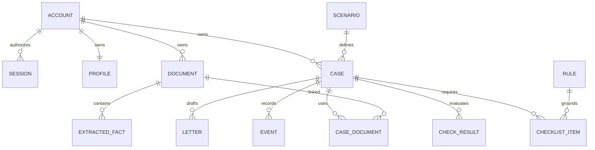

# VisaPilot — предметная модель и словарь

Статус: продуктовые определения согласованы; поля, связи и инварианты уточнены инженерно для прототипа. 25 октября 2026 года.

## Канонические определения

| Термин | Определение |
|---|---|
| Аккаунт | Учётная запись VisaPilot, владеющая профилем, архивом, делами и результатами. Не является входом в ChatGPT |
| Сессия | Ограниченный по времени серверный доступ к аккаунту после входа |
| Заявитель | Один взрослый турист — гражданин РФ, проживающий в РФ, без второго гражданства/иностранного ВНЖ |
| Профиль | Общие ответы и паспортные характеристики заявителя с номером ревизии |
| Направление | Одна из 12 утверждённых стран назначения |
| Сценарий | Версионируемый туристический путь для страны с условиями применимости, требованиями и шаблоном процесса |
| Поездка | Даты, цель, назначение, место подачи, финансирование и маршрут конкретного дела |
| Дело | Сопровождение одного заявителя по одному сценарию для одной поездки; принадлежит аккаунту |
| Личный архив | Документы аккаунта, доступные повторно и независимо от отдельных дел |
| Документ | Логическое доказательство определённого типа, включающее файл и извлечённые факты |
| Исходный файл | Загруженные байты PDF/изображения; в синтетическом демо сохраняются в закрытой локальной папке |
| Привязка документа | Использование своего архивного документа в конкретном деле; не копирует проверку из другого дела |
| Извлечённый факт | Значение поля с происхождением, уверенностью распознавания и подтверждением конкретной ревизии |
| Правило | Версионируемые условия и следствия с источником; не произвольное решение AI |
| Источник | Конкретная публикация, URL, орган, дата фактической проверки и качество данных |
| Требование | Обязательное, условное или рекомендованное доказательство/действие при применимости правила |
| Smart Checklist | Применённые к делу требования с состояниями, объяснениями, источниками и замечаниями |
| Пункт чек-листа | Экземпляр требования в деле; может ссылаться на несколько документов или ручное действие |
| Проверка | Применение версии правила/явно обозначенной эвристики к определённым ревизиям фактов дела |
| Замечание | Найденная проблема с тяжестью, основанием, затронутыми полями и следующим действием |
| Готовность пакета | Выполнение обязательных применимых требований подготовки по доступным правилам и подтверждённым полям |
| Этап процесса | Действие или состояние в шаблоне визы, e-Visa или безвизовой подготовки |
| Прогресс процесса | Отдельное от готовности пакета выполнение применимых этапов по ручным событиям |
| Исход | unknown/approved/refused/not_applicable; не выводится из процента готовности или возврата паспорта |
| Событие | Сообщение о действии/изменении с источником, временем события и временем получения |
| Уведомление | Информация о новом событии/замечании/следующем действии внутри кабинета |
| Участок маршрута | Перемещение между пунктами с датами и характеристиками билета |
| Пересадка | Переход между участками с условиями транзитной зоны, багажа, границы и разрешений |
| Черновик письма | Редактируемый текст из подтверждённых фактов с указанием способа генерации и недостающих данных |
| Устаревший результат | Проверка/черновик, входная подпись которого отличается от текущих ревизий дела, профиля, документов или правил |

## Связи

- Один аккаунт — один профиль заявителя и несколько дел. В каждом деле одна страна/сценарий; пересадки не считаются вторым сценарием назначения.
- Документ принадлежит аккаунту независимо от дел. CASE_DOCUMENT связывает документ со своим делом; принадлежность проверяется по обоим объектам.
- Один документ может подтверждать несколько требований; требование может использовать несколько документов.
- Исходный файл, извлечённые поля и результаты проверок имеют разные жизненные циклы. Удаление дела не удаляет архив.
- CheckResult связан с делом и версией входов. Его нельзя хранить единственным глобальным статусом «документ проверен».
- Пункт чек-листа связан с требованием/источником; внешние действия процесса имеют отдельный вклад в прогресс.
- Правило связано с источником и версией; одинаковый rule_id в новой версии не переписывает историю уже выполненной проверки.

## Минимальные группы хранения

SQLite: users, sessions, profiles, cases, documents, case_documents, checklist_actions, check_results, routes, letters, events. Поля/снимки внутри JSON хранятся только после проверки Pydantic. Активные правила читаются из версионируемых файлов; источники сохраняются в составе версии набора. Конкретный DDL создаёт владелец пакета 1.

Файловое хранилище: закрытая папка оригиналов и временная OCR-папка. Пути не являются публичными URL и не возвращаются клиенту.

## Инварианты

1. Владелец определяется сессией, а не переданным owner_id; чтение и изменение чужого ресурса запрещены.
2. Файл загружен ≠ требование выполнено; распознано ≠ подтверждено пользователем.
3. Проверка не нашла ошибку ≠ консульство одобрит заявление.
4. Неизвестное условие не считается выполненным; null не равен false.
5. Один файл в двух делах проверяется относительно двух поездок и версий правил.
6. Удаление документа снимает все его привязки, удаляет оригинал/поля и отменяет актуальность зависимых результатов.
7. Удаление дела сохраняет документы в общем архиве; выход из аккаунта не удаляет данные.
8. Обновление анкеты, факта или набора правил не сохраняет молча старый положительный результат.
9. Готовность пакета не переводит дело в «подано»; возврат паспорта не устанавливает исход.
10. Безвизовый сценарий не получает фиктивную визовую подачу.
11. Непокрытая страна транзита означает неизвестные условия, а не допустимый маршрут.
12. AI-эвристика не получает статус официального требования.

Точные модели HTTP и внутренние функции: [contracts.md](contracts.md). Формулы и ограничения обработки: [engineering-decisions.md](engineering-decisions.md).
